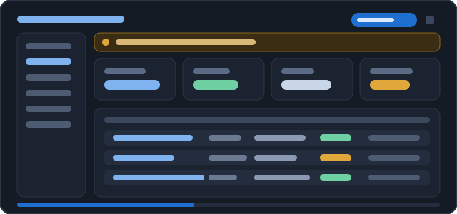

# 仙宫云镜像管家 · dsh-xiangongyun

把 [仙宫云（XGC）](https://www.xiangongyun.com) 的 GPU 实例与私有镜像搬进 DeepSeek Harness 的 Web 界面：
侧栏一行实时数字、一个悬浮面板、一页完整管理台，外加两个给 agent 用的工具。



> 插件 ID `dsh-xiangongyun`，本仓库名 `dsh-xiangongyun-manage`。

---

## 功能

**侧栏一行**（和「服务器状态」同类入口并列）

```
● 仙宫云
[ 1 运行 ] [ ¥1.59/h ] [ ¥100.00 ]
```

余额、运行中实例数、每小时花费。开机/关机/存镜像结束的瞬间就会变，空闲时按「兜底刷新」间隔更新。

**悬浮弹窗**（点上面那一行，440px，贴左下角）

- 四个指标：余额 / 运行中的实例 / 私有镜像 / 镜像占用
- 警告：余额低于阈值、实例连续运行过久、镜像长期未更新
- 进行中的任务：存镜像、开机、部署、抢卡的实时进度
- 实例卡片：开机、存镜像、详情、运行中可直接关机释放 GPU
- 底部可切 3s / 5s / 10s 自动刷新；点面板外或 Esc 关闭

**全屏控制台 / 设置页**（弹窗右上角「展开」，或 设置 → 仙宫云镜像）

六个 tab：概览、实例、镜像、部署、账号、设置。镜像表支持搜索、按大小/时间排序、标签筛选、批量删除、
本地标签与备注、保留白名单；部署向导支持从私有/社区/公共镜像起一台新实例。

**抢卡**

开机时若平台提示没有可用 GPU，自动每 1 秒重试一次，默认最多 5 分钟（可配置）。抢到立即结束，
超时或遇到非资源类错误立即停止，不会拿无效请求去刷接口。

**本地标注层**（平台没有的能力）

给镜像打标签、写备注、上「保留白名单」——白名单里的镜像删除会被拒绝。数据只存在本机。

**ComfyUI 地址**

实例详情里直接给出 ComfyUI 访问地址（仙宫云把容器端口映射为 `<实例ID>-<端口>.container.x-gpu.com`，
默认取 8188，可配置），带复制按钮，关机时提示需开机。

**给 agent 的两个工具**

- `xiangongyun_images`：概览、列表、详情、打标签、清理计划、删除
- `xiangongyun_instances`：列表、详情、该实例存过的镜像、开机、关机、释放 GPU、存镜像、存镜像并销毁、部署、销毁

销毁类操作必须在参数里原样写出目标名/ID，否则拒绝；真正的授权仍由界面上的输入确认。

---

## 运行环境要求

| 项 | 要求 | 说明 |
|---|---|---|
| **DSH** | `0.2.2-rc.5`（实测）及以上 0.2.x | 依赖 `webServer` / `settings` / `credentials` 服务与 `shell.overlay` / `settings.section` / `sidebar.footer.action` 槽位；DSH 改槽位名时需同步升级本插件 |
| **Node.js** | ≥ 22（推荐 24） | 使用 `AbortSignal.timeout`、`fetch`、`node:fs` 等内置能力；由 DSH 提供，**插件本身零依赖，无需 npm install** |
| **系统** | Linux / macOS / Windows，**Termux(Android) 实测可用** | 纯 JavaScript，无编译、无原生模块、无 Python、无数据库、无构建步骤 |
| **浏览器** | DSH Web GUI（如 `http://127.0.0.1:3080`） | 需要现代浏览器（Chromium/Firefox/Safari 近两年版本）；界面跟随 DSH 主题的浅色/深色 |
| **账号** | 仙宫云账号 + 访问令牌 | 令牌在 <https://www.xiangongyun.com/a/API> 生成 |
| **网络** | 能访问 `https://api.xiangongyun.com` | 请求由 DSH 的 Host 进程发出，不经过浏览器 |

不需要：`pnpm` 构建、`python`、Docker、单独起服务或额外端口。

---

## 安装

```bash
git clone https://github.com/MasterZJJ/dsh-xiangongyun-manage.git
```

然后二选一：

**A. 界面安装**：打开 DSH → **Plugins → Add plugin** → 选择刚 clone 下来的目录（该目录里有 `package.json`）。

**B. 命令行/agent 安装**：让 agent 调用 `plugin_manager` 工具：

```json
{ "action": "install_bundle", "target": "/绝对路径/dsh-xiangongyun-manage" }
```

安装结果里 `application: applied` 表示已生效；若返回 `nextStep`，按提示重启 `dsh web`。
装好后侧栏底部会出现「仙宫云」一行。

---

## 首次配置

1. 打开 <https://www.xiangongyun.com/a/API> 生成访问令牌。
2. 点侧栏「仙宫云」→ 弹窗右上角「展开」→ **设置** tab；或直接 **设置 → 仙宫云镜像 → 设置**。
3. 粘贴令牌 → **保存并校验**。成功会显示昵称与手机号后缀。

令牌**不写入配置文件**，而是存进 DSH 的凭据库（键 `xiangongyun/access-token`），页面只显示末 4 位。
也可以用环境变量 `XGC_API_TOKEN` 作为兜底（凭据库优先）。

---

## 配置项

全部可在 **设置 → 仙宫云镜像 → 设置** 或「设置 → Plugins → 本插件」里改，写到 profile 的 patch，重启后保留。

| 键 | 默认 | 说明 |
|---|---|---|
| `apiBase` | `https://api.xiangongyun.com` | 接口根地址，一般不用改 |
| `refreshSeconds` | `30` | 设置页/全屏台的自动刷新间隔（弹窗另有自己的 3/5/10s） |
| `sidebarRefreshMinutes` | `10` | 侧栏兜底刷新间隔；开机/关机/存镜像结束时**立即**刷新，不受此值限制 |
| `gpuGrabMinutes` | `5` | 抢卡时长（分钟），`0` 关闭自动抢卡 |
| `comfyuiPort` | `8188` | 实例详情里 ComfyUI 地址用的容器端口 |
| `gpuModels` | 4090 / 4090 48G / 4090 D / 4090 D 48G | 开机与部署下拉框的可选项，平台变更时可自行覆盖 |
| `dataCenterId` | `1` | 部署时默认的数据中心 ID |
| `storagePricePerGbHour` | `0.00003` | 估算镜像存储费的单价（元/GB/小时），仅用于展示 |
| `balanceWarnBelow` | `20` | 余额低于此值告警，`0` 关闭 |
| `longRunningWarnHours` | `6` | 实例连续运行超过此小时数告警，`0` 关闭 |
| `staleImageWarnDays` | `90` | 镜像超过此天数未更新视为可清理，也是清理计划的阈值 |
| `confirmDestructive` | `true` | 销毁/删除时要求手动输入目标名 |
| `localOnly` | `true` | 只接受本机回环直连（见下方「安全」的说明） |
| `saveImageSendName` | `false` | 保留字段：实测平台会忽略 `image_name`，开关无实际效果 |
| `workdir` | 空 | 本地数据目录，空 = `~/.dsh-xiangongyun` |

---

## 安全

- **令牌**只在 DSH 凭据库，配置、日志、接口响应里都没有明文；页面只显示末 4 位。
- **实例敏感字段**（SSH 密码、Jupyter Token、COS Token）默认不出 Host，只回「有没有」；点「显示」时单独取一次并写入审计日志。
- **危险操作**（销毁实例、删除镜像、存镜像并销毁、批量删除）要求手动输入目标名或 `DELETE N`，删不掉的保留镜像会被拒绝。
- **接口只接受同源请求**，并默认只接受本机回环直连。
  注意：若你通过 LAN 网关访问 DSH，网关会把请求从 `127.0.0.1` 转发过来，插件无法与本地请求区分——
  那一层的访问控制由网关口令负责，本插件挡不住「已登录网关的人」。
- **审计**：所有变更操作、明文读取、令牌变更都记在 `~/.dsh-xiangongyun/audit.jsonl`。

---

## 已知限制（均为实测结论）

- **存镜像要求实例已关机**：运行中调用会被平台拒绝（`请关机后执行储存镜像操作`）；关机后还要等磁盘备份完成。
- **平台用 UUID 命名镜像**：显式下发 `image_name` 会被忽略，界面上显示为「未命名镜像 · 前8位」，请用标签/备注区分。
- **重启后的实例不回传本次开机时间**：`start_timestamp` 仍是首次启动时间，因此运行时长与今日花费显示为 `≥`，并注明「按距上次关机估算，偏大」。
- **「关机（保留 GPU）」仍然计费**：要停止计费请用「关机释放 GPU」，磁盘按 GB/小时 小计费。
- **抢卡依赖错误文案**：匹配「GPU/显卡 + 不足/无可用/暂无/售罄…」，若平台换了说法可能不触发；此时把提示原文反馈过来即可补充。
- **费用是估算**：按接口返回的每小时单价 × 今天已过时长，加镜像是 `size × 单价` 的推算，不是账单。
- **ComfyUI 地址是端口约定推导**：平台未提供该字段，按 `<实例ID>-<端口>.container.x-gpu.com` 拼出；端口不同请在设置里改。
- **列表接口无分页**：个人规模够用，客户端做了行数截断。

---

## 数据文件

都在 `~/.dsh-xiangongyun/`（可用 `workdir` 改）：

| 文件 | 内容 |
|---|---|
| `annotations.json` | 镜像的标签、备注、保留白名单 |
| `cost-log.jsonl` | 成本采样 |
| `audit.jsonl` | 操作审计（变更、明文读取、令牌变更） |
| `cache.json` | 最近一次快照，断网时兜底展示 |

删除该目录不影响账号状态，只会丢掉本地标注与历史。

---

## 接口来源

基于仙宫云开放接口（`https://api.xiangongyun.com`，`Authorization: Bearer <令牌>`）。
接口文档见官方 [API Playground](https://api-playground.xiangongyun.com/)。
本插件对接时逐项核对了官方原文，并记录了与文档不符之处（见上「已知限制」）。

---

## 开发

- 客户端是**手写的单文件模块**（`client.js`，`window.__ModuleLoader__.load`），无 JSX、无构建、无第三方 UI 库，
  样式只用 DSH 的主题变量（`--dsw-alias-*`），以便跟随浅色/深色。
- 改 Host 侧代码（`index.js` / `service.js` / `jobs.js` / `xgc.js` / `tools.js`）后，用 `plugin_manager`
  `set_bundle` 关一次再开一次即可重新加载模块，不必重启 `dsh web`。
- 改 `client.js` 后刷新页面即可。
- 离线自测（零依赖）：

```bash
node test/jobs.test.mjs          # 任务状态机：save/deploy/stop/destroy/抢卡/超时
node test/client-apply.test.mjs  # 用假 ctx 执行真实 client.js，校验四个槽位注册
```

---

## License

[MIT](LICENSE) © MasterZJJ
